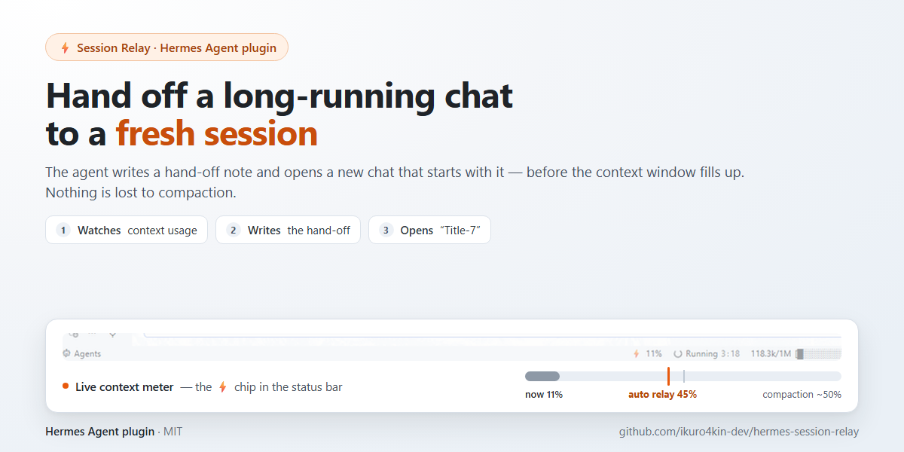

# Эстафета сессий — плагин для Hermes Agent



**Передаёт длинный рабочий чат в новую сессию до того, как переполнится контекст.**

Hermes сжимает беседу, когда контекст доходит примерно до 50% окна модели. Сжатие оставляет краткое резюме и выбрасывает детали; после двух-трёх сжатий длинная рабочая сессия превращается в кашу из полузабытых фактов и дублей в ленте. «Эстафета сессий» решает ту же задачу с другой стороны: когда контекст подходит к порогу, агент пишет передачу и открывает **новый чат**, который начинается с этой передачи, — а старый чат остаётся нетронутым и читаемым.

## Как это работает

1. Десктопная половина следит за заполнением контекста активной сессии.
2. Когда заполнение переходит порог (по умолчанию 45%) и текущий ход завершён, она отправляет **скрытое служебное сообщение**: агент отвечает самой передачей (текущая задача, состояние, что сделано, следующий шаг, важные детали).
3. Плагин открывает новый чат через SDK (`host.newChat()`) и отправляет передачу в него (`host.composer.submit('new', note)`) — новая сессия начинается с этой передачи как с первого сообщения пользователя, ровно как если бы её напечатал ты.
4. Новый чат получает имя текущего с номером +1: `Bugfix-6` → `Bugfix-7`.
5. Тост и системное уведомление сообщают о готовом чате; по клику он открывается.
6. Кнопка ⚡ в строке состояния запускает эстафету вручную — в том числе ниже порога.

Ничего не удаляется: прежняя сессия остаётся в списке как полная запись.

На каналах вне десктопа (Telegram и другие мессенджеры) порядок ручной: агент готовит передачу, ты отправляешь `/new`, а gateway-половина вкладывает её первым сообщением новой сессии.

## Требования

- **Hermes Agent 0.22.0 или новее**, с приложением Desktop (`apps/desktop`) и/или шлюзом.
- Инструмент агента не нужен: десктопная половина открывает и наполняет новый чат через SDK плагинов (`host.newChat`, `host.composer`), у gateway-половины есть свой инструмент `session_relay_handoff`.

## Состав пакета

Это **единый пакет**: один плагин, две половины.

```
session-relay/
├── plugin.yaml      # манифест (имя, версия, объявленные хуки)
├── __init__.py      # gateway-половина: вкладывает передачу после /new
└── desktop/
    └── plugin.js    # десктоп-половина: счётчик контекста, порог, служебное сообщение
```

## Установка

**Из Git (рекомендуется):**

```bash
hermes plugins install https://github.com/ikuro4kin-dev/hermes-session-relay
```

Пакет попадёт в `$HERMES_HOME/plugins/session-relay/`. Дальше:

1. **Gateway-половина (по желанию)** — включи в `config.yaml`:

   ```yaml
   plugins:
     enabled: [session-relay]
     entries:
       session-relay:
         allow_gateway_injection: true
   ```

2. **Десктоп-половина** — в Hermes Desktop открой **Capabilities → Plugins → Rescan**, затем включи **Session Relay**. Обе половины по умолчанию выключены.
3. После включения Python-половины перезапусти шлюз (`hermes gateway restart`).

**Только десктоп, без gateway-половины:** скопируй `desktop/plugin.js` в
`$HERMES_HOME/desktop-plugins/session-relay/plugin.js` (Windows: `%LOCALAPPDATA%\hermes\desktop-plugins\session-relay\plugin.js`) и включи плагин в **Settings → Plugins**. Сборка не нужна, зависимостей нет: это один ESM-файл.

## Настройки (десктоп)

| Настройка | Значение |
|---|---|
| **Automatic relay** (автоматическая эстафета) | Запускать передачу автоматически при достижении порога. |
| **Trigger threshold** (порог) | 30 / 40 / 45 / 50%. По умолчанию 45% — ниже точки, где Hermes сжимает историю сам (~50%). |
| **Reset marks** (сбросить отметки) | Забыть, что эстафета для текущей сессии уже запускалась (нужно для теста). |

## Как пользоваться gateway-половиной (Telegram и другие каналы)

1. Попроси агента сделать эстафету (передачу) для текущей беседы.
2. Отправь `/new` (или `/reset`).
3. Плагин вложит подготовленную передачу первым сообщением пользователя в новой сессии и даст ей прежнее название с номером +1.
4. Подготовленная передача действительна 24 часа; если она старше — игнорируется.

На этих каналах порядок ручной по замыслу: со стороны шлюза плагин не видит счётчика заполнения контекста.

## Раскрытие (Disclosure)

Что плагин делает с данными и токенами:

- Каждая эстафета отправляет агенту **одно служебное сообщение**, то есть запускает обычный ход агента — это расход токенов, как и любой другой ход.
- Текст передачи агент составляет по текущей беседе и отправляет в композер нового чата; он становится первым сообщением пользователя в новой сессии.
- Десктопная половина хранит в своём хранилище два ключа: `prefs` (настройки) и `relayed` (id сессий, где эстафета уже была; чистятся через 30 дней).
- Gateway-половина пишет `pending.json` в собственной папке (текст передачи, имя платформы) и удаляет его после вложения; записи старше 24 часов игнорируются.
- Сетевых вызовов нет, телеметрии нет, доступа к оболочке нет, к файлам вне своей папки — нет. Всё идёт через штатные API плагинов Hermes.

## Ограничения

- Обе половины опираются на API плагинов Hermes (`session.context_breakdown`, `prompt.submit`, `host.newChat`, `host.composer`, событие `message.complete` и хук `on_session_reset`). В будущих версиях Hermes они могут измениться — тогда плагин потребует обновления.
- Автоматический запуск есть только в десктопе; в Telegram и других каналах шлюза — ручной порядок, описанный выше.
- Эстафета выполняется только когда сессия свободна (она никогда не прерывает идущий ход).

## Лицензия

MIT — см. [LICENSE](LICENSE).
