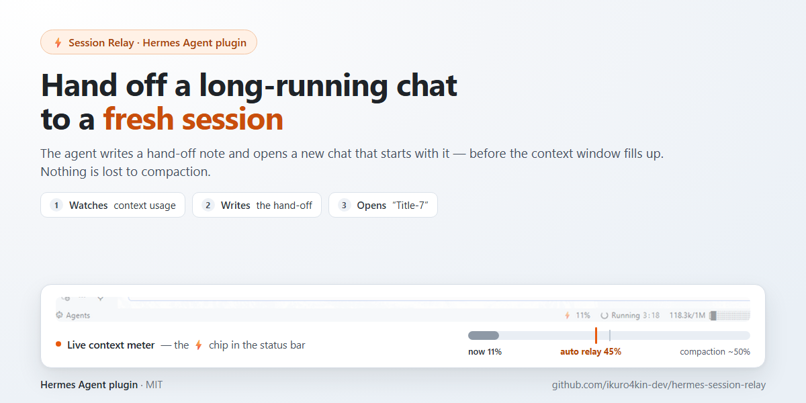

# Эстафета сессий — плагин для Hermes Agent



**Передаёт длинный рабочий чат в новую сессию до того, как переполнится контекст.**

Hermes сжимает беседу, когда контекст доходит примерно до 50% окна модели. Сжатие оставляет краткое резюме и выбрасывает детали; после двух-трёх сжатий длинная рабочая сессия превращается в кашу из полузабытых фактов и дублей в ленте. «Эстафета сессий» решает ту же задачу с другой стороны: когда контекст подходит к порогу, агент пишет передачу и открывает **новый чат**, который начинается с этой передачи, — а старый чат остаётся нетронутым и читаемым.

## Как это работает

1. Десктопная половина следит за заполнением контекста активной сессии.
2. Когда заполнение переходит порог (по умолчанию 45%) и текущий ход завершён, она отправляет **скрытое служебное сообщение**: агент отвечает самой передачей (текущая задача, состояние, что сделано, следующий шаг, важные детали).
3. Плагин открывает новый чат через SDK (`host.newChat()`) и отправляет передачу в него (`host.composer.submit('new', note)`) — новая сессия начинается с этой передачи как с первого сообщения пользователя, ровно как если бы её напечатал ты.
4. Новый чат получает имя текущего с номером +1: `Bugfix-6` → `Bugfix-7`.
5. Тост и системное уведомление сообщают о готовом чате; по клику он открывается.
6. Кнопка ⚡ в строке состояния запускает эстафету вручную — в том числе ниже порога.

Ничего не удаляется: прежняя сессия остаётся в списке как полная запись.

На каналах вне десктопа (Telegram и другие мессенджеры) порядок ручной: агент готовит передачу, ты отправляешь `/new`, а gateway-половина прикрепляет её к первому обычному сообщению в новой сессии — оно открывается передачей как заголовочным блоком.

## Требования

- **Hermes Agent 0.22.0 или новее**, с приложением Desktop (`apps/desktop`) и/или шлюзом.
- Инструмент агента не нужен: десктопная половина открывает и наполняет новый чат через SDK плагинов (`host.newChat`, `host.composer`), у gateway-половины есть свой инструмент `session_relay_handoff`.

## Состав пакета

Это **единый пакет**: один плагин, две половины.

```
session-relay/
├── plugin.yaml      # манифест (имя, версия, объявленные хуки/инструменты)
├── __init__.py      # gateway-половина: хранилище передач по чатам, carry после /new, хук pre_gateway_dispatch
└── desktop/
    └── plugin.js    # десктоп-половина: счётчик контекста, порог, служебное сообщение
```

## Установка

**Из Git (рекомендуется):**

```bash
hermes plugins install https://github.com/ikuro4kin-dev/hermes-session-relay
```

Пакет попадёт в `$HERMES_HOME/plugins/session-relay/`. Дальше:

1. **Gateway-половина (по желанию)** — включи в `config.yaml`:

   ```yaml
   plugins:
     enabled: [session-relay]
     entries:
       session-relay:
         allow_gateway_injection: true
   ```

2. **Десктоп-половина** — в Hermes Desktop открой **Capabilities → Plugins → Rescan**, затем включи **Session Relay**. Обе половины по умолчанию выключены.
3. После включения Python-половины перезапусти шлюз (`hermes gateway restart`).

**Только десктоп, без gateway-половины:** скопируй `desktop/plugin.js` в
`$HERMES_HOME/desktop-plugins/session-relay/plugin.js` (Windows: `%LOCALAPPDATA%\hermes\desktop-plugins\session-relay\plugin.js`) и включи плагин в **Settings → Plugins**. Сборка не нужна, зависимостей нет: это один ESM-файл.

## Настройки (десктоп)

| Настройка | Значение |
|---|---|
| **Automatic relay** (автоматическая эстафета) | Запускать передачу автоматически при достижении порога. |
| **Trigger threshold** (порог) | 30 / 40 / 45 / 50%. По умолчанию 45% — ниже точки, где Hermes сжимает историю сам (~50%). |
| **Reset marks** (сбросить отметки) | Забыть, что эстафета для текущей сессии уже запускалась (нужно для теста). |

## Как пользоваться gateway-половиной (Telegram и другие каналы)

1. Попроси агента сделать эстафету (передачу) для текущей беседы. Он вызывает инструмент **`session_relay_handoff`**, передавая текст передачи в `text`; передача сохраняется в `$HERMES_HOME/plugin-data/session-relay/` под id сессии этого чата.
2. Отправь `/new` (или `/reset`).
3. Плагин откладывает подготовленную передачу для этого чата и даёт новой сессии прежнее название с номером +1.
4. Твоё следующее обычное сообщение в этом чате — не команда — открывается передачей как заголовочным блоком. Это сделано намеренно: у новой сессии ещё нет ни одного завершённого хода, и session authority шлюза отказывается её наполнять (`not_found`), поэтому передача едет на первом реальном сообщении, а не теряется.
5. Передача привязана к чату, который её подготовил (id его сессии): подхватить её может только этот чат — передача из другой беседы не прикрепляется никогда. Отложенная передача выбрасывается, если чат ушёл дальше (ещё один `/new`, восстановленная сессия).
6. Подготовленная передача действительна 24 часа; если она старше — игнорируется.

Инструмент живёт в наборе `session_relay`. Он включается вместе с плагином; если ты выключал набор в `hermes tools`, включи его обратно для нужной платформы.

## Автоматическая эстафета на каналах шлюза

По умолчанию выключена. Когда включена, поток-сторож внутри шлюза раз в тик проверяет каждый маршрутизированный чат на настроенных платформах:

- **контекст** — размер последнего API-запроса чата как доля окна модели (читается из хвоста `logs/agent.log`);
- **тишина** — в чате нет хода минимум `auto_min_idle_seconds`, и ни один ход не выполняется прямо сейчас;
- **та же поверхность** — последний ход этой сессии вёл тот же канал; сессию, которой управлял десктоп, сторож не трогает.

После порога плагин шлёт агенту один служебный ход с просьбой собрать передачу. Как только передача сохранена и ход завершён, сессия чата сбрасывается через штатную воронку `/new` шлюза (без текста и без названия). Твоё следующее обычное сообщение в этом чате открывается передачей — тот же carry-механизм, что и в ручном порядке. Ничего не вставляется, не сбрасывается и не переписывается, пока идёт ход.

Настройки — в `plugins.entries.session-relay.settings`:

| Настройка | По умолчанию | Значение |
|---|---|---|
| `auto_handoff` | `false` | Главный выключатель; читается на каждом тике, перезапуск не нужен. |
| `auto_threshold_percent` | `45` | Доля окна модели, при которой срабатывает эстафета. |
| `auto_min_idle_seconds` | `60` | Сколько чат должен молчать. |
| `auto_poll_seconds` | `60` | Тик сторожа. |
| `auto_channels` | `["telegram"]` | Какие платформы сторожить (`telegram`, `api_server`, …). |

Ставятся через `hermes config set`, например:

```
hermes config set plugins.entries.session-relay.settings.auto_handoff true
hermes config set plugins.entries.session-relay.settings.auto_threshold_percent 45
```

Одна сессия переносится не чаще одного раза в сутки: id сессий, по которым эстафета уже запускалась, сторож помнит в `auto_state.json` в своей папке данных, поэтому перезапуск шлюза не запустит ту же эстафету второй раз.

## Раскрытие (Disclosure)

Что плагин делает с данными и токенами:

- Каждая эстафета отправляет агенту **одно служебное сообщение**, то есть запускает обычный ход агента — это расход токенов, как и любой другой ход.
- Текст передачи агент составляет по текущей беседе и отправляет в композер нового чата; он становится первым сообщением пользователя в новой сессии.
- Десктопная половина хранит в своём хранилище два ключа: `prefs` (настройки) и `relayed` (id сессий, где эстафета уже была; чистятся через 30 дней).
- Gateway-половина пишет по одному файлу передачи на чат в `$HERMES_HOME/plugin-data/session-relay/` (текст передачи, id сессии чата, время); после `/new` она переносит передачу в carry-файл этого чата и удаляет его, как только её подхватило следующее сообщение (или если чат ушёл дальше). Файлы старше 24 часов вычищаются.
- Сторож автоматической эстафеты читает **хвост `logs/agent.log`** (id сессии, размер последнего API-запроса, модель, платформа), чтобы понять, заполнен ли чат; он пишет `auto_state.json` в своей папке данных (id сессий, где эстафета уже была; чистятся через 24 часа). Текст сообщений он не читает и с машины никуда не выходит.
- Сетевых вызовов нет, телеметрии нет, доступа к оболочке нет, к файлам вне своей папки, каталога `plugin-data` и хвоста лога выше — нет. Всё остальное идёт через штатные API плагинов Hermes.

## Ограничения

- Обе половины опираются на API плагинов Hermes (`session.context_breakdown`, `prompt.submit`, `host.newChat`, `host.composer`, событие `message.complete` и хуки `on_session_reset` + `pre_gateway_dispatch`). В будущих версиях Hermes они могут измениться — тогда плагин потребует обновления.
- Автоматический запуск работает в десктопе и, по желанию, на каналах шлюза (`auto_handoff`). Gateway-половина измеряет контекст по строке лога, которую Hermes пишет после каждого API-запроса; если в будущем релизе строку переименуют, сторож просто промолчит, а ручной порядок продолжит работать.
- Эстафета выполняется только когда сессия свободна (она никогда не прерывает идущий ход).

## Лицензия

MIT — см. [LICENSE](LICENSE).
